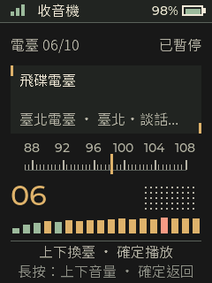

# Passport OS 繁中臺北版

讓 FoloToy AI Passport 顯示繁體中文、保留彩色頭像，並直接收聽十個臺北與臺灣電臺。

**版本：`0.2.0-rc.56-tw-scroll`** · [English](docs/README.en.md) · [文件目錄](docs/index.md) · [版本紀錄](CHANGELOG.md)

本專案是 [manchunx7-bit/passport-os](https://github.com/manchunx7-bit/passport-os) 的衍生版本，以 `0.2.0-rc.56` 為基礎。適用硬體為 **FoloToy AI Passport、ESP32-C3、8 MB Flash**；其他外觀相似的 ESP32 板子不能直接套用。



## 從這裡開始

| 你的目的 | 對應文件 |
| --- | --- |
| 裝置已裝好，想知道怎麼用 | [日常操作與功能](docs/USAGE.zh-TW.md) |
| 想安裝、升級或回復舊版 | [備份、建置與燒錄](docs/INSTALL.zh-TW.md) |
| 想換彩色頭像、改簽名或名片 | [個人資料與彩色頭像](docs/USAGE.zh-TW.md#個人資料彩色頭像與名片) |
| 電臺沒聲音、連不上網或頭像仍是單色 | [疑難排解](docs/TROUBLESHOOTING.zh-TW.md) |
| 想修改程式、電臺或字型 | [開發與驗證](docs/DEVELOPMENT.zh-TW.md) |

目前這個版本以原始碼發布，**GitHub 的 Source code ZIP 不是可燒錄的韌體**。需要自行建置，或使用與本版本、硬體及分割區相符的已建置鏡像。從上游下載其他版本的二進位檔，不會自動包含本 fork 的修改。

## 這版新增的功能

| 功能 | 實際行為 |
| --- | --- |
| 繁體中文介面 | 系統選單、應用程式與手機設定頁使用繁體中文，保留產品名稱與通訊識別字 |
| 繁中顯示與字型 | 思源黑體 TC 字型子集；動態中文以顯示副本轉換，不改寫原始資料 |
| 首頁簽名跑馬燈 | 想說的話超出欄位寬度時橫向循環捲動，短文字維持靜止 |
| 單色／彩色首頁頭像 | 已存彩色照片可隨時切換顯示方式並保留原色；96 × 138 像素，最多 255 色加透明背景，保留舊單色格式讀取 |
| 固定臺北電臺清單 | 十臺內建清單，不會被自動城市搜尋覆蓋 |
| HLS 電臺相容性 | 支援這份清單的純音訊 HLS；音訊變體上限為 384 kbit/s |
| 可重現的資源工具 | 固定字型轉換器版本、驗證原字型 SHA256，附第三方授權與功能測試 |

既有首頁、天氣、名片、收音機、隨身語音、小智 AI、Muse、遊戲、碼錶、番茄鐘與系統設定沿用上游功能。網路與帳號需求見[功能對照表](docs/USAGE.zh-TW.md#功能與使用條件)。

## 收音機內建哪十臺

| 序號 | 電臺 | 串流 |
| --- | --- | --- |
| 1 | ICRT | AAC 直連 |
| 2 | 中廣新聞網 | AAC 直連 |
| 3 | 中廣流行網 | AAC 直連 |
| 4 | 中廣音樂網 | AAC 直連 |
| 5 | 九八新聞台 | AAC 直連 |
| 6 | 飛碟電台 | AAC 直連 |
| 7 | 臺北健康電臺 | MP3 直連 |
| 8 | 臺北廣播電臺 | HLS／AAC |
| 9 | 警廣臺北臺 | HLS／AAC |
| 10 | 警廣全國網 | HLS／AAC |

短按上鍵切下一臺，短按下鍵切上一臺，短按確定播放／暫停，長按確定返回應用程式選單。電臺網址定義在 [radio_presets.h](main/apps/radio/radio_presets.h)，來源仍可能變更，詳見[電臺維護方式](docs/DEVELOPMENT.zh-TW.md#修改電臺清單)。

## 已裝好這版的裝置

1. 開機後短按確定，開啟應用程式選單。
2. 用上下鍵選擇「城市收音機」，短按確定開啟。
3. 裝置連上已儲存的 Wi-Fi 後開始播放；上下鍵換臺，確定鍵暫停。
4. 要更換頭像或資料，在首頁長按下鍵進入「手機設定」。

手機設定時，連接裝置畫面顯示的 `Passport-WiFi-…` 熱點，瀏覽器開啟 `http://192.168.4.1`。日常網路電臺及 AI 功能使用的是已設定的路由器 Wi-Fi，不是這個設定熱點。

「首頁人像」提供明確的「單色／彩色」選擇。已上傳彩色照片時，切成單色後仍保留原色，可直接切回彩色，不必重新上傳；按完成設定後才生效。舊格式單色頭像沒有原始 RGB 資料，需要重新上傳原始彩色照片，切換主題無法還原。

## 開發者快速建置

使用 **ESP-IDF 5.5.3** 與 ESP32-C3 工具鏈；首次安裝 SDK 的方式與平台限制見[安裝文件](docs/INSTALL.zh-TW.md)。

```bash
git clone https://github.com/lunkerchen/passport-os.git
cd passport-os
IDF_DIR=/path/to/esp-idf bash build.sh release
```

把 `/path/to/esp-idf` 換成 ESP-IDF 5.5.3 的實際安裝目錄。產物：

- `build-public/passport-os.bin`：應用程式鏡像；相同分割區配置的升級寫入 `0x10000`。
- `build-public/FoloToy-AI-Passport-full.bin`：完整安裝鏡像；寫入 `0x0`。

**先備份並核對分割區，再選擇鏡像。** 完整鏡像會覆蓋其寫入範圍內的設定；整片清除也會清掉個人資料。一般升級不要直接套用完整安裝指令。完整步驟見[安裝與回復指南](docs/INSTALL.zh-TW.md)。

## 驗證到哪裡

前一版已在實際 ESP32-C3 上確認十個電臺解碼產生 PCM 並送入裝置音訊輸出，彩色頭像亦經實機 RGB 色塊驗證。單色／彩色切換已通過主機、瀏覽器及實機測試，確認重新開機後保留選擇與原始色彩。本版另以不同時間的實機截圖確認長簽名會捲動、短簽名保持靜止，並完成首頁重入、記憶體與個人資料保留檢查。

- [本版簽名跑馬燈驗證](docs/verification-tw-scroll.json)
- [單色／彩色切換驗證](docs/verification-tw-portrait.json)
- [前版實機驗證紀錄](docs/verification-tw-radio.json)
- [測試指令與已知限制](docs/DEVELOPMENT.zh-TW.md#執行測試)

這些紀錄不等同人耳音質評測、不保證外部電臺永久可用，也不代表所有語音服務已完成帳號設定。字型為子集，不能宣稱任意 Unicode 都有字形。完整上游主機測試在 macOS 有既有相容性限制，文件僅列出實際通過的檢查。

## 資料、授權與來源

韌體中的 Wi-Fi、個人資料、照片與服務憑證由使用者在自己的裝置上設定。Git 僅保留原始碼、測試及不含個人資料的驗證摘要；完整 Flash 備份及原始裝置日誌不適合公開上傳。

- 原作：[manchunx7-bit/passport-os](https://github.com/manchunx7-bit/passport-os)
- 原作者的隨身語音電腦端：[folo-ai-passport-voice](https://github.com/manchunx7-bit/folo-ai-passport-voice)
- 原作者的 Muse 專案：[ai-passport-muse](https://github.com/manchunx7-bit/ai-passport-muse)
- 專案授權：[MIT](LICENSE)
- 字型與轉換資料：[第三方資源與授權](docs/THIRD-PARTY-zh-TW.md)
- Muse 圖像：[Jollybot 使用聲明](main/apps/muse/JOLLYBOT-NOTICE.md)

原作者及各第三方資源的著作權與授權維持不變。舊版技術報告保留供追溯，與本版行為不同時，以這份 README、本版操作指南及目前程式碼為準。
