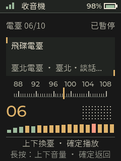

# Passport OS 繁中臺北版

[原專案說明](README.md) · [English](docs/README.en.md) · [本版驗證紀錄](docs/verification-tw-radio.json)

適用於 FoloToy AI Passport 的 ESP32-C3／8 MB Flash 硬體。本 fork 以 [manchunx7-bit/passport-os](https://github.com/manchunx7-bit/passport-os) 的 `0.2.0-rc.56` 為基礎，加入繁體中文介面、彩色首頁頭像和臺北電臺固定清單。韌體版本為 `0.2.0-rc.56-tw-radio`。

## 這版改了什麼

| 功能 | 行為 |
| --- | --- |
| 繁體中文 | 系統、各應用程式與手機設定頁使用繁體中文；動態中文字串只轉換顯示副本，保留原始儲存值與通訊資料 |
| 繁中字型 | 使用思源黑體 TC 產生 LVGL 子集，補齊介面字形；仍不代表支援任意 Unicode 字元 |
| 彩色首頁頭像 | 96 × 138 像素、最多 255 種照片色彩加透明背景；保留舊版單色格式相容性 |
| 臺北電臺 | 固定 10 臺，避免自動城市搜尋覆蓋個人選定清單 |
| HLS 相容性 | 純音訊變體位元率上限提高至 384 kbit/s，仍拒絕影片和不支援的加密串流 |

保留上游十款應用程式及主題、音量、亮度、休眠、Wi-Fi 和個人資料功能。桌面語音轉發器與小智 MCP 電腦工具屬於各自獨立專案，不包含在這份韌體中。

## 電臺清單與操作

1. ICRT
2. 中廣新聞網
3. 中廣流行網
4. 中廣音樂網
5. 九八新聞台
6. 飛碟電台
7. 臺北健康電臺
8. 臺北廣播電臺
9. 警廣臺北臺
10. 警廣全國網

短按上鍵切下一臺，短按下鍵切上一臺，短按確定播放／暫停，長按確定返回；長按上下鍵調整音量。串流網址定義在 `main/apps/radio/radio_presets.h`。警廣採用官方伺服器的公開 HTTP 1935 入口，避開在此裝置上實測遇到的 HTTPS 音訊片段 TLS 讀取錯誤。



## 建置與安裝

準備 ESP-IDF **5.5.3**、對應 ESP32-C3 工具鏈和 Git。建置工具沿用上游腳本：

```bash
git clone --branch feature/zh-tw-color-taipei-radio https://github.com/lunkerchen/passport-os.git
cd passport-os
IDF_DIR=/path/to/esp-idf bash build.sh release
```

產物為 `build-public/passport-os.bin` 與 `build-public/FoloToy-AI-Passport-full.bin`。已安裝本專案且分割區表完全相同時，備份後只更新應用程式：

```bash
python -m esptool --chip esp32c3 --port YOUR_SERIAL_PORT --baud 460800 \
  write-flash 0x10000 build-public/passport-os.bin
```

`YOUR_SERIAL_PORT` 請換成目前裝置序列埠。此版沿用上游 4 MB factory 應用程式分割區與 2 MB storage；不能將應用程式鏡像套用到其他分割區配置。首次安裝和不同韌體移轉請先閱讀[上游安裝說明](docs/open-source-guide-draft-20261025.md)。完整鏡像與整片清除會影響設定，勿當成一般升級指令。

## 彩色頭像

裝置開啟「手機設定」，手機連接裝置熱點後進入 `http://192.168.4.1`，在「首頁人像」重新上傳原始照片，選擇「彩色」，確認取景後儲存。舊單色頭像未保留原圖色彩，無法由韌體準確還原；需重新上傳彩色原圖。

## 重新產生字型與字碼表

已生成的 C 字型與映射表包含於原始碼，一般建置不用重新生成。修改中文文案後，準備 Node.js／npm 與 `uv`，執行：

```bash
uv run --with opencc-python-reimplemented==0.1.7 python tools/generate_zhtw_glyph_map.py
uv run --with opencc-python-reimplemented==0.1.7 python tools/generate_zhtw_fonts.py
```

字型工具會將官方思源黑體 TC 下載到忽略的 `.cache/fonts/`，驗證 SHA256，再使用 `lv_font_conv@1.5.3` 產生各尺寸字型。來源及授權見 [第三方資源說明](docs/THIRD-PARTY-zh-TW.md)。

## 測試與驗證範圍

```bash
python tests/test_zh_tw_display.py
node tests/test_portrait_pixels.js
python tests/test_color_portrait_storage.py
python tests/test_avatar_upload.py
python tests/test_home_portrait_lifecycle.py
python tests/test_radio_source.py
c++ -std=c++17 -Wall -Wextra -Werror -fsanitize=address,undefined \
  -Imain tests/test_radio_hls.cc -o /tmp/passport-radio-hls
/tmp/passport-radio-hls
```

此版已在實際 ESP32-C3 上逐臺確認十個電臺解碼產生 PCM 並送入音訊輸出；彩色頭像亦以實機截圖的 RGB 色塊驗證。這不等同人耳音質評測，也不保證電臺串流永久可用。

上游完整主機測試腳本在 macOS Clang 會遇到既有的 C++ `-Wnon-c-typedef-for-linkage` 錯誤，部分主機指令也使用 Linux 連結器選項，因此沒有宣稱完整上游測試套件通過。上述針對本次功能的測試、公開韌體建置與大小／SRAM 預算檢查均已執行。

## 資料與授權

Git 僅保存原始碼、測試、說明與不含個人資料的驗證摘要。裝置完整備份、NVS、個人照片、簽名、Wi-Fi 密碼、Token 與原始執行日誌留在本機，不上傳。

專案沿用上游 [MIT 授權](LICENSE)，原作者與第三方資源的著作權及各自授權維持不變。感謝 FoloToy、原作者及上游貢獻者。
