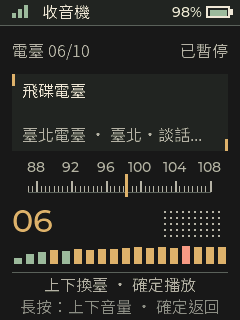

# Passport OS — Traditional Chinese / Taipei Edition

[繁體中文](../README.md) · [Documentation index](index.md) · [Changelog](../CHANGELOG.md)

Community firmware for the **FoloToy AI Passport, ESP32-C3, 8 MB Flash**, based on [manchunx7-bit/passport-os](https://github.com/manchunx7-bit/passport-os) `0.2.0-rc.56`. This fork's firmware version is **`0.2.0-rc.56-tw-portrait`**.

## What this fork adds

| Feature | Behavior |
| --- | --- |
| Traditional Chinese UI | Localized application and phone setup text, TC font subsets, and display-only conversion for dynamic CJK strings |
| Color/monochrome home portraits | Switch a stored color photo between original color and theme monochrome without re-uploading; the original palette remains intact |
| Fixed Taipei/Taiwan radio list | Ten built-in stations; automatic city discovery does not replace the list |
| Audio HLS compatibility | Audio-only variants up to 384 kbit/s, with unsupported video/encryption formats still rejected |
| Reproducible resources | Pinned font converter, source-font checksum, third-party licenses, and targeted regression tests |

The upstream home screen, weather, business cards, games, stopwatch, pomodoro timer, voice apps, and system settings remain available.



## User guides

The detailed guides are currently in Traditional Chinese:

- [Backup, build, installation, upgrade, and recovery](INSTALL.zh-TW.md)
- [Buttons, Wi-Fi, portraits, cards, radio, and voice features](USAGE.zh-TW.md)
- [Troubleshooting](TROUBLESHOOTING.zh-TW.md)
- [Source layout, fonts, station changes, and testing](DEVELOPMENT.zh-TW.md)

This fork is currently distributed as source. A GitHub Source code ZIP is **not** a flashable image. An upstream release binary does not automatically contain this fork's changes.

## Radio presets

1. ICRT
2. BCC News / 中廣新聞網
3. BCC Pop / 中廣流行網
4. BCC Music / 中廣音樂網
5. News98 / 九八新聞台
6. UFO Radio / 飛碟電台
7. Taipei Health Radio / 臺北健康電臺
8. Taipei Broadcasting Station / 臺北廣播電臺
9. Police Broadcasting Service Taipei / 警廣臺北臺
10. Police Broadcasting Service National / 警廣全國網

Short UP selects the next station; short DOWN selects the previous station; short OK toggles playback; long OK returns to the launcher. Long UP/DOWN adjusts the shared system volume. Streams require an Internet-connected Wi-Fi network and may change over time.

## Build

Use **ESP-IDF 5.5.3** with the ESP32-C3 toolchain:

```bash
git clone https://github.com/lunkerchen/passport-os.git
cd passport-os
IDF_DIR=/path/to/esp-idf bash build.sh release
```

Replace `/path/to/esp-idf` with the actual SDK directory containing `export.sh`.

| Output | Purpose | Address |
| --- | --- | --- |
| `build-public/passport-os.bin` | Application-only update with an identical partition table | `0x10000` |
| `build-public/FoloToy-AI-Passport-full.bin` | Full installation image | `0x0` |

Back up the complete device before writing. Compare the device partition table with the build before an application-only update. A full image can overwrite configuration within its write range; a full-chip erase also removes data. See the [installation guide](INSTALL.zh-TW.md) for the exact commands and recovery conditions.

## Color portraits

Open Phone Setup on the device, connect the phone to the displayed `Passport-WiFi-…` access point, and browse to `http://192.168.4.1`. In Home Portrait, choose monochrome or color and save. Stored color photos can switch modes without selecting or uploading a new source image; the original colors remain intact. When replacing a photo, crop and preview before saving.

Existing monochrome files no longer contain their original RGB values. A theme change cannot recover them; upload the original photo again. Portraits use a compact indexed format rather than full-resolution lossless photo storage.

## Voice and PC control are separate setups

- **Voice input on a computer:** requires the separate [voice forwarder](https://github.com/manchunx7-bit/folo-ai-passport-voice), a virtual audio device, and a compatible input method. macOS uses BlackHole 2ch; Windows uses VB-CABLE.
- **Xiaozhi voice conversations:** require network access and the corresponding Xiaozhi account/service setup.
- **Xiaozhi MCP computer tools:** require a backend MCP endpoint and a separate computer bridge/tool server, such as the [official MCP sample](https://github.com/78/mcp-calculator).

USB power does not turn this firmware into a USB microphone or install a desktop control application. Muse requires the user's own service credentials and pairing.

## Verification and limits

[The current verification summary](verification-tw-portrait.json) records the successful build, renderer, storage, browser, and device tests. The actual ESP32 retained monochrome mode across a reset, restored the original RGB palette, and preserved the user's original avatar/profile. [The previous version's device record](verification-tw-radio.json) separately retains successful decoding/PCM output for all ten stations.

The radio check was not a human listening assessment. Font coverage remains a subset. External stations and AI services require their own availability and setup. The full upstream host suite has pre-existing macOS Clang/linker compatibility issues, so only the documented targeted checks are claimed as passing.

## Credits and licenses

The project retains the upstream [MIT license](../LICENSE) and attribution. Source Han Sans TC and OpenCC have their own notices, preserved in the [third-party resource guide](THIRD-PARTY-zh-TW.md). Muse artwork follows the [Jollybot notice](../main/apps/muse/JOLLYBOT-NOTICE.md).

Device backups, credentials, personal profile data, photos, and raw device logs are kept out of the public source repository.
